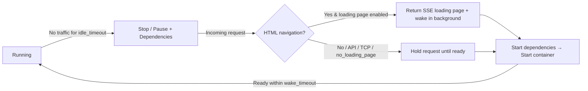

Idle sleep stops or pauses infrequently used containers after a period of inactivity and wakes them automatically when a request arrives. Works across **Docker**, **Podman** (Docker-compatible API), and **Proxmox LXCs** for **HTTP**, **TCP**, and **UDP** routes.

## Lifecycle



- **HTML navigations**: GoDoxy immediately serves a loading page that streams wake progress over Server-Sent Events (SSE) and refreshes once the app is ready. Closing the browser tab does not cancel the in-progress wake.
- **Non-HTML requests (APIs, webhooks, TCP/UDP) or `no_loading_page: true`**: GoDoxy holds the connection until the container is ready (up to `wake_timeout`) and then proxies the original request.
- All start, ready, sleep, pause, and error transitions appear in the WebUI **Live Activity** feed.

## Quick Setup (Docker Compose)

Add `proxy.idle_timeout` to the main app container:

```yaml
services:
  app:
    image: myorg/app:latest
    labels:
      proxy.idle_timeout: 30m
      # Optional tuning:
      # proxy.wake_timeout: 1m
      # proxy.stop_method: stop        # stop | pause | kill
      # proxy.stop_timeout: 1m
      # proxy.stop_signal: SIGTERM
      # proxy.start_endpoint: /wake    # Only wake when this path is hit
      # proxy.no_loading_page: false
    depends_on:
      db:
        condition: service_healthy

  db:
    image: postgres:16
    healthcheck:
      test: ["CMD-SHELL", "pg_isready -U postgres"]
      interval: 5s
      timeout: 3s
      retries: 5
```

For Proxmox LXCs, configure `idlewatcher:` in your route file — see [Proxmox Integration](../getting-started/Proxmox#idle-sleep-integration).

## Dependency Management

<Callout type="warn">
  Do **not** set `idle_timeout` on dependency containers (like `db` or `redis`).
  GoDoxy starts and stops them automatically through `depends_on`.
</Callout>

- **Wake order**: Transitive dependencies start first; GoDoxy waits for `service_started` or `service_healthy` before starting the main container.
- **Shared dependencies**: When a container sleeps, its dependencies stop **unless** another running watched route still depends on them.
- **Podman**: Compose dependencies are auto-discovered via Podman's native inspect API (enable `CONTAINERS` on GoDoxy's socket-proxy). Because Podman's API does not store Compose health conditions, discovered dependencies default to `service_started` — override with `proxy.depends_on: redis:service_healthy,postgres:service_started` if needed.

## Sleep and Wake Notifications

Notifications are off by default. Configure providers under `providers.notification`, then enable them globally or per route:

```yaml
# Global default in config/config.yml (does not enable idle sleep by itself)
defaults:
  idlewatcher:
    notify:
      to: [gotify] # Use notify: {} to broadcast to all notification providers
```

- **Per-route override (route file)**: Set `idlewatcher.notify.to: [ntfy]`, or opt a single route out with `idlewatcher.notify.to: []`.
- **Per-container override (Docker labels)**: Set `proxy.idle_notify_to: gotify,ntfy`, or opt out with `proxy.idle_notify_to: ""`.
- Notifications fire for sleep/pause and wake transitions only (not initial discovery, reloads, readiness, errors, or dependency-only containers).

## Property Reference

| Property | Description | Default | Values |
| --- | --- | --- | --- |
| `idle_timeout` | Inactivity duration before sleeping (**required**) | Disabled | Go duration (`15m`, `1h30s`) |
| `wake_timeout` | Max wait for container readiness on wake | `3m` | Go duration |
| `stop_method` | Action used to sleep the container | `stop` | `stop`, `pause`, `kill` |
| `stop_timeout` | Max wait for stop/kill confirmation | `1m` | Go duration |
| `stop_signal` | Signal for `stop`/`kill` | Docker default | `SIGINT`, `SIGTERM`, `SIGQUIT`, `SIGKILL` (with or without `SIG`) |
| `start_endpoint` | Restrict wake triggers to a specific path | Any path | Relative URI (e.g. `/api/wake`) |
| `no_loading_page` | Wait inline instead of showing the SSE loading page | `false` | boolean |

With `stop_method: kill`, GoDoxy waits up to `stop_timeout` for the runtime to confirm the container stopped before stopping dependencies. Signals that don't stop the process (like `SIGHUP`) time out and leave dependencies running.
