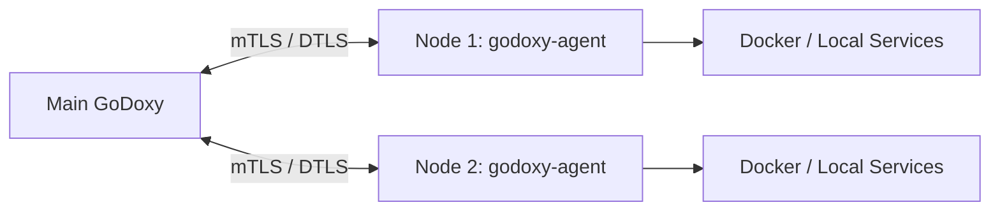

To proxy containers and stream metrics from additional servers, run **`godoxy-agent`** on each remote host. It communicates with your main GoDoxy instance over encrypted **mTLS** (HTTP/TCP) and **DTLS+mTLS** (UDP).



`godoxy-agent` handles reverse proxying (HTTP, h2c, HTTPS), TCP/UDP forwarding, Docker API access, health checks, and host metrics (CPU, memory, disk, network, GPU).

## Option 1: Docker Agent (Recommended)

1. In the GoDoxy WebUI, open the **Servers** tab and click **Add agent**.
2. Choose **Docker**, fill in the agent details, and click **Copy docker compose**.
3. On the remote server, save that snippet to `compose.yml` in a new directory and start it:

```shell
docker compose up -d
```

<Callout type="info" title="Intel GPU metrics on Linux">
  The **GPU Usage** graph reads Linux `i915` perf counters, which requires
  `CAP_PERFMON`. Add `cap_add: [PERFMON]` to the agent service (and ensure your
  seccomp profile allows `perf_event_open`, which current Docker defaults do).
  Without it, GPU metrics are skipped and a startup warning is logged — set
  `GODOXY_METRICS_DISABLE_GPU=true` to silence it. Do not use `privileged: true`
  just for metrics.
</Callout>

## Option 2: System Agent (Bare-Metal / LXC)

The system agent runs directly on Linux hosts without Docker and supports both `systemd` and Alpine/OpenRC (`rc-service`).

1. In the GoDoxy WebUI, open **Servers** → **Add agent** → select **System**.
2. Fill in the details, click **Copy shell command**, and run it on the remote host.

### Update or Uninstall

```shell
# Update (safe to run from cron)
sh -c "$(curl -fsSL https://raw.githubusercontent.com/yusing/godoxy/refs/heads/main/scripts/install-agent.sh)" -- update

# Uninstall
sh -c "$(curl -fsSL https://raw.githubusercontent.com/yusing/godoxy/refs/heads/main/scripts/install-agent.sh)" -- uninstall
```

## Legacy Alternative: `docker-socket-proxy`

<Callout type="warn">
  **Not recommended.** Exposing a raw `docker-socket-proxy` over TCP is
  unencrypted and lacks host metrics and proxying. Use `godoxy-agent` unless you
  have a specific constraint.
</Callout>

On the remote host:

```yaml
services:
  docker-proxy:
    container_name: docker-proxy
    image: lscr.io/linuxserver/socket-proxy:latest
    environment:
      - ALLOW_START=1
      - ALLOW_STOP=1
      - ALLOW_RESTARTS=1
      - CONTAINERS=1
      - EVENTS=1
      - INFO=1
      - PING=1
      - POST=1
      - VERSION=1
    volumes:
      - /var/run/docker.sock:/var/run/docker.sock
    restart: always
    tmpfs:
      - /run
    ports:
      - <remote-ip>:2375:2375
```

Then register the node in `config/config.yml`:

```yaml
providers:
  docker:
    local: $DOCKER_HOST
    server-1: tcp://<remote-ip>:2375
```
