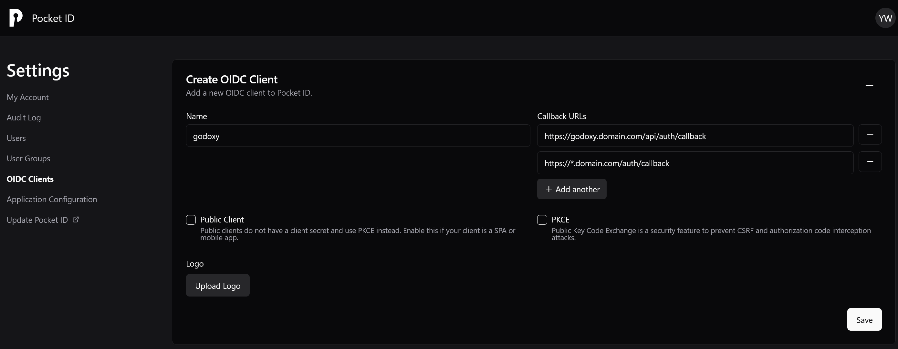
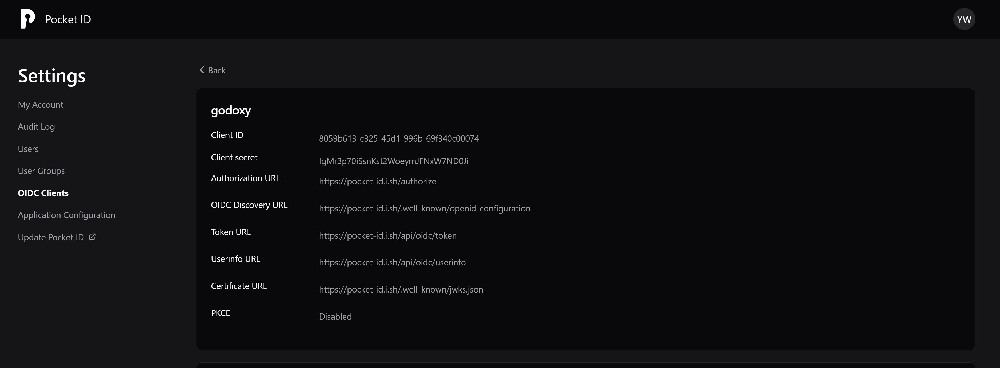

Use OpenID Connect (OIDC) with an external identity provider (such as Pocket ID, Authentik, or Keycloak) for:

- **WebUI SSO**: Sign in to the GoDoxy dashboard with your IdP instead of `GODOXY_API_USER`/`GODOXY_API_PASSWORD`.
- **Per-App Protection**: Gate individual routes behind OIDC using the [OIDC Middleware](../advanced-topics/middlewares/authentication-and-security/OIDC).

## 1. Configure Your Identity Provider

Register this callback URL in your IdP (replacing `yourdomain.com` with your domain):

```plaintext
https://*.yourdomain.com/auth/callback
```

If your IdP requires a regular expression instead of a wildcard:

```plaintext
https:\/\/([^\.]+)\.yourdomain\.com\/auth\/callback
```

### Provider Notes

- **Authentik**:
  1. Set **Signing Key** to `authentik Self-signed Certificate` and **Encryption Key** to `None`.
  2. Set **Issuer mode** to *Each provider has a different issuer, based on the application slug*.
  3. Add the scope `authentik default OAuth Mapping: OpenID 'offline_access'`.
- **Pocket ID**:

  

  

## 2. Add OIDC Settings to `.env`

```dotenv
GODOXY_OIDC_ISSUER_URL=https://id.yourdomain.com
# For Authentik, use the per-app issuer: https://auth.yourdomain.com/application/o/<slug>/
GODOXY_OIDC_CLIENT_ID=your-client-id
GODOXY_OIDC_CLIENT_SECRET=your-client-secret

# At least one of ALLOWED_USERS or ALLOWED_GROUPS must be set
GODOXY_OIDC_ALLOWED_USERS=user1,user2
GODOXY_OIDC_ALLOWED_GROUPS=admins
```

| Variable | Description | Default |
| --- | --- | --- |
| `GODOXY_OIDC_ISSUER_URL` | IdP issuer URL (empty disables global OIDC) | empty |
| `GODOXY_OIDC_CLIENT_ID` | OAuth client ID | empty |
| `GODOXY_OIDC_CLIENT_SECRET` | OAuth client secret | empty |
| `GODOXY_OIDC_ALLOWED_USERS` | Comma-separated allowed usernames/emails | empty |
| `GODOXY_OIDC_ALLOWED_GROUPS` | Comma-separated allowed groups | empty |
| `GODOXY_OIDC_SCOPES` | Requested scopes (`openid` and `profile` required; `email`, `groups`, `offline_access` optional) | `openid,profile,email,groups` |
| `GODOXY_OIDC_RATE_LIMIT` | Login requests allowed per period | `10` |
| `GODOXY_OIDC_RATE_LIMIT_PERIOD` | Rate-limit window | `1s` |

Once these variables are set, WebUI OIDC login is active automatically.

## 3. Protect Individual Apps (Optional)

Add the `oidc` middleware to any route — omitted fields inherit from `GODOXY_OIDC_*`, or you can supply a standalone `issuer_url` per app without enabling global OIDC:

```yaml
# Docker Compose label (inherits global GODOXY_OIDC_*)
services:
  app:
    labels:
      proxy.#1.middlewares.oidc:
```

<Callout type="warn">
  The OIDC middleware only handles `GET` requests (non-`GET` requests and
  WebSockets without an existing session return `403 Forbidden`), and reserves
  `/auth/callback` and `/auth/logout` on protected hosts. If you enable `oidc`
  globally on `entrypoint.middlewares`, always add your IdP route to `bypass` to
  avoid a redirect loop.
</Callout>

See [OIDC Middleware](../advanced-topics/middlewares/authentication-and-security/OIDC) for standalone per-app issuers, `scopes` list syntax, and bypass rules.
