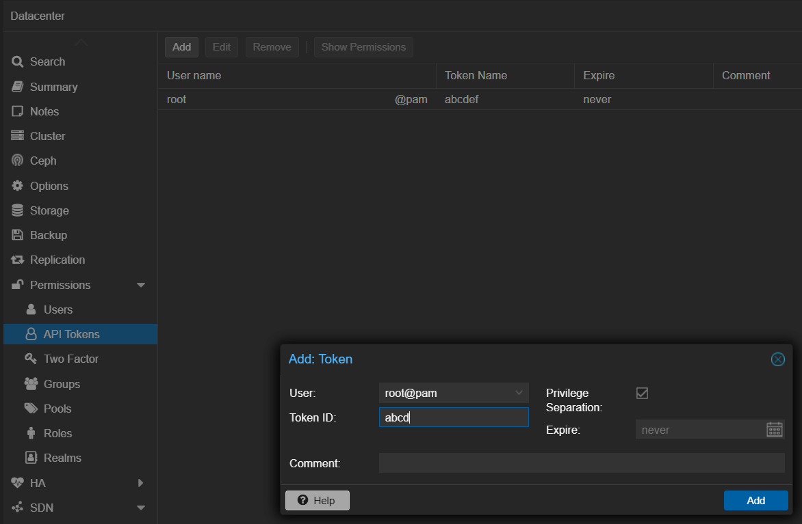
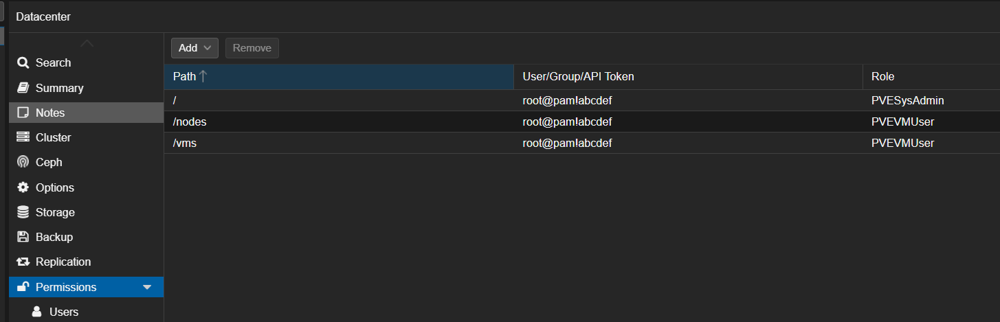
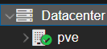
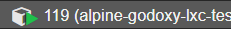

GoDoxy integrates with Proxmox VE to auto-discover nodes and LXC containers, stream real-time CPU/memory/disk/network stats and `journalctl` logs in the WebUI, run LXC power controls (start, stop, restart, suspend, resume), and support [Idle Sleep](../advanced-topics/Idle-Sleep) on LXC containers.

## 1. Choose Authentication Method

| Capability | API Token (Recommended) | Username + Password |
| --- | --- | --- |
| Node & LXC discovery, stats, power controls, idle sleep | Yes | Yes |
| WebSocket `journalctl` log streaming & container command execution | No | **Required** |

### Creating an API Token

1. In Proxmox VE, go to **Datacenter → Permissions → API Tokens → Add** (e.g. user `root@pam`, token ID `godoxy`).

   

2. Grant these permissions to the token: `VM.Audit`, `VM.Console`, `VM.Monitor`, `VM.PowerMgmt`, `Sys.Audit`.

   

## 2. Add the Provider in `config/config.yml`

```yaml
providers:
  proxmox:
    - url: https://pve.domain.com:8006 # /api2/json is appended automatically if omitted
      token_id: root@pam!godoxy
      secret: ${PVE_TOKEN_SECRET}
      no_tls_verify: true
      # Optional: required only for WebSocket journalctl log streaming
      # username: root
      # password: ${PVE_PASSWORD}
      # realm: pam
```

| Field | Description | Required |
| --- | --- | --- |
| `url` | Proxmox API base URL (port `8006`) | Yes |
| `token_id` / `secret` | API token credentials | Either token or user/pass |
| `username` / `password` / `realm` | Session credentials (needed for WebSocket logs) | For `journalctl` logs |
| `no_tls_verify` | Skip TLS verification for self-signed PVE certs | No (`false`) |

## 3. Link Routes to Nodes & LXCs

GoDoxy links routes in your route files (`config/*.yml`) to Proxmox resources in two ways:

### Automatic Binding (Recommended)

Omit the `proxmox:` block — GoDoxy automatically reverse-matches the route's alias, hostname, or IP against discovered Proxmox node names, LXC names, and LXC interface IPs:

```yaml
# config/proxmox.yml
pve:
  host: 10.0.0.1
  port: 8006
  scheme: https
  no_tls_verify: true # Automatically binds to node "pve" (VMID 0)

my-lxc:
  host: 10.0.9.50
  port: 3000          # Automatically binds to the LXC owning 10.0.9.50
```

### Explicit Binding

Specify `node`, `vmid`, and an optional systemd `service` name (for filtering container `journalctl` logs) when auto-discovery cannot match unambiguously:

```yaml
my-lxc:
  host: 10.0.9.50
  port: 3000
  proxmox:
    node: pve      # Node name from Proxmox UI
    vmid: 119      # LXC container ID
    service: nginx # Optional: filter journalctl logs to this unit
```

<Callout type="info">
  `vmname` is populated automatically from the Proxmox API — do not set it
  manually in route files.
</Callout>





## Idle Sleep Integration

Add `idlewatcher:` to any Proxmox LXC route to stop it when idle and wake it on traffic (including `depends_on` for dependent LXCs):

```yaml
lxc-app:
  host: 10.0.9.50
  port: 3000
  proxmox:
    node: pve
    vmid: 119
  idlewatcher:
    idle_timeout: 30m
    wake_timeout: 60s
    depends_on:
      - lxc-db

lxc-db:
  host: 10.0.9.51
  port: 5432
  proxmox:
    node: pve
    vmid: 120
```

See [Idle Sleep](../advanced-topics/Idle-Sleep) for all options and [API Reference](/docs/openapi) for the `/api/v1/proxmox/*` stats, logs, and lifecycle endpoints.

## Troubleshooting

- **`failed to fetch proxmox cluster info`**: Check reachability to port `8006` from GoDoxy and set `no_tls_verify: true` if PVE uses a self-signed certificate.
- **`authentication failed`**: Confirm `token_id` uses `user@realm!token-name` format and has the five permissions listed above.
- **`proxmox node '<name>' not found`**: Verify the node name matches Proxmox exactly and is online.
- **`no session found, make sure username and password are set`**: WebSocket `journalctl` streaming requires `username` and `password` in addition to (or instead of) the API token.
